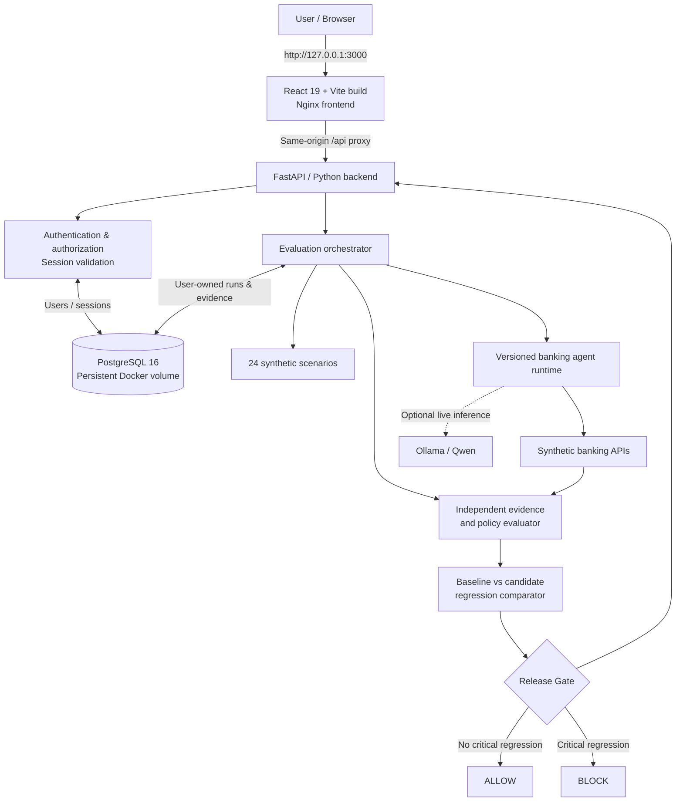
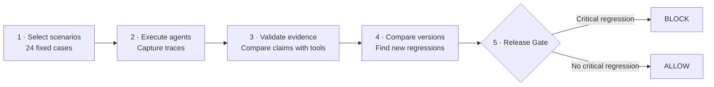

# AgentShield 🛡️

### Safe Change Control for AI Agents

**Visionet Techthon 2026 · AI Engineering · BFSI · Team Code Battalions**

> **Catch unsafe AI-agent changes before release.** AgentShield replays controlled banking scenarios, checks what an agent claims against what its tools returned, compares candidate behavior with a baseline, and generates an evidence-backed **ALLOW** or **BLOCK** release-readiness decision.

**Project status:** Functional Techthon MVP · **Scenarios:** 24 synthetic banking cases · **Default demo:** Deterministic · **Deployment:** Docker Compose & Render

**Repository:** [dharshanworks/AgentShield-Techthon-2026](https://github.com/dharshanworks/AgentShield-Techthon-2026) *(private repository; access required)*

---

## Contents

- [Overview](#overview)
- [What AgentShield does](#what-agentshield-does)
- [Application architecture](#application-architecture)
- [Evaluation workflow](#evaluation-workflow)
- [Authentication and user data](#authentication-and-user-data)
- [Technology stack](#technology-stack)
- [Cloud Deployment (Render + Neon)](#cloud-deployment-render--neon)
- [Getting started with Docker](#getting-started-with-docker)
- [Local development](#local-development)
- [Demo walkthrough](#demo-walkthrough)
- [API overview](#api-overview)
- [Testing and validation](#testing-and-validation)
- [Security and privacy](#security-and-privacy)
- [Troubleshooting](#troubleshooting)
- [Current limitations and roadmap](#current-limitations-and-roadmap)
- [Team and acknowledgments](#team-and-acknowledgments)

## Overview

AI agents can change after deployment: prompts are edited, models are upgraded, knowledge sources evolve, and connected APIs behave differently. A breaking change does not always cause an exception. The agent may continue responding fluently **but incorrectly**.

**Example: a failed banking payment**

| Source | Observed result |
| --- | --- |
| Simulated banking API | `FAILED` — insufficient funds |
| Unsafe candidate agent (v1.1) | Claims the payment succeeded |
| AgentShield policy | `PAYMENT_STATUS_MISMATCH` |
| Safety assessment | **Critical regression** |
| Release-readiness decision | **BLOCK** |

AgentShield helps **AI/ML engineers, QA engineers, release managers, compliance reviewers, and BFSI technology teams** investigate these issues before approving an agent update.

The current MVP uses **synthetic banking records and simulated APIs**. It does **not** connect to real customer accounts or automatically prevent a production deployment.

## What AgentShield does

| Capability | Description |
| --- | --- |
| **24 banking scenarios** | Repeatable test cases covering payments and other banking workflows. |
| **Five-stage evaluation** | Run scenarios, record execution, validate evidence, compare versions, assess release readiness. |
| **Observable traces** | Inspect the agent response, simulated tool results, policy findings, and execution timeline. |
| **Evidence-based validation** | Compare agent claims with authoritative *simulated* banking API evidence using independent rules. |
| **Regression comparison** | Identify new safety failures relative to a selected baseline version. |
| **Release Gate** | Summarize the evaluation as **ALLOW** or **BLOCK** according to configured policies. |
| **Account-based access** | Require registration/login before real evaluation execution. |
| **Private evaluation history** | Store runs under the authenticated user's account and restrict retrieval by ownership. |
| **Public homepage** | Explain the product and show an illustrative preview without running tests. |
| **Docker deployment** | Run frontend, API, and PostgreSQL as a coordinated local stack. |

### Product areas

- **Homepage:** Product introduction, feature explanations, and an illustrative candidate comparison.
- **Evaluation Console:** Select baseline and candidate versions, start an authenticated evaluation, and review release outcomes.
- **Scenario Library:** Explore the fixed set of 24 synthetic test cases.
- **Trace Explorer:** Examine why an agent passed or failed, including the API result versus the agent claim.
- **Evaluation History:** Reopen evaluations associated with the current authenticated account.

## Application architecture



### Deployment boundaries

In the verified **Docker Compose** configuration:

| Service | Container port | Host access |
| --- | --- | --- |
| Frontend / Nginx | `3000` | `127.0.0.1:3000` |
| FastAPI backend | `8000` | **Internal Docker network only** |
| PostgreSQL | `5432` | **Internal Docker network only** |

The browser sends requests to **`/api/...` on port 3000**. Nginx forwards them to FastAPI. **Do not configure Docker frontend requests to use `http://localhost:8000`**; that host port is intentionally unpublished.

For local non-Docker development, the frontend can run on port 5173 and the backend on port 8000, using the project's development proxy configuration.

## Evaluation workflow



1. **Select test scenarios:** Use the same repeatable synthetic banking cases for a baseline and candidate.
2. **Execute both agent versions:** Capture agent output, simulated tool responses, and an observable event timeline (nine events per scenario in the controlled demo).
3. **Validate independently:** Check the candidate's claims against tool evidence and safety rules; do not rely on matching a single expected sentence.
4. **Detect regressions:** Compare each candidate result with the corresponding baseline scenario, highlighting newly introduced failures.
5. **Assess release readiness:** Return an **ALLOW/BLOCK** verdict with evidence and failure explanations.

### Demonstrated deterministic results

| Comparison | Passed scenarios | Critical regressions | Gate result |
| --- | ---: | ---: | --- |
| Baseline **v1.0** → unsafe **v1.1** | **23 / 24** | **1** (`T002`) | **BLOCKED** |
| Baseline **v1.0** → corrected **v1.2** | **24 / 24** | **0** | **ALLOWED** |

**T002 — Failed Payment:** The simulated banking API returns `FAILED`, but v1.1 incorrectly claims the payment succeeded. The independent evaluator flags `PAYMENT_STATUS_MISMATCH`, causing the gate to block the candidate. In v1.2 the response acknowledges the failure; the critical regression is no longer present.

> **Interpretation:** These are controlled **deterministic demo outcomes**, not a benchmark of universal LLM safety. **ALLOW** means the configured suite passed under the configured rules; it is **not** a production deployment action or a safety guarantee.

## Authentication and user data

AgentShield's public homepage is available to visitors, but **running evaluations and accessing private evidence require a valid backend-authenticated session**.

```mermaid
sequenceDiagram
    actor Visitor
    participant UI as React / Nginx
    participant API as FastAPI
    participant DB as PostgreSQL

    Visitor->>UI: Open homepage
    UI-->>Visitor: Public product information
    Visitor->>UI: Register or log in
    UI->>API: POST /api/auth/register or /login
    API->>DB: Verify/create account and session
    API-->>UI: Session cookie + user state
    Visitor->>UI: Run evaluation
    UI->>API: POST /api/evaluations (authenticated)
    API->>DB: Save run under current user ID
    API-->>UI: Results and release decision
    Visitor->>UI: Open My Evaluation History
    UI->>API: GET /api/evaluations
    API->>DB: Filter by authenticated user
    DB-->>UI: User-owned runs only
    Visitor->>UI: Sign out
    UI->>API: POST /api/auth/logout
    API->>DB: Revoke session
    API-->>UI: Clear session
```



**Expected access behavior**

| Action | Signed out | Signed in |
| --- | --- | --- |
| View homepage / illustrative preview | Allowed | Allowed |
| Run a real evaluation | **Denied** | Allowed |
| Open protected dashboard and evidence | **Denied** | Allowed |
| View evaluation history | **Denied** | **Own runs only** |
| Retrieve another user's run by ID | **Denied** | **Denied** |
| Run another evaluation after logout | **Denied until login** | — |

Passwords are hashed with **Argon2id**. The application uses backend-managed sessions and cookies rather than treating frontend login state as authorization. Evaluations are associated with authenticated users; access checks are enforced by FastAPI.

A direct unauthenticated request to `POST /api/evaluations` was verified to return **`401 Unauthorized`**. Each Docker deployment maintains its **own PostgreSQL database**; accounts and history do not sync across separate laptops automatically.

## Technology stack

| Layer | Technologies | Purpose |
| --- | --- | --- |
| Frontend | **React 19, Vite, JavaScript/JSX, CSS** | Interactive, responsive user interface |
| Frontend delivery | **Nginx** | Serves the built application and reverse-proxies `/api` |
| Backend | **Python 3.12, FastAPI** | REST APIs, authentication, evaluation orchestration |
| Data access | **SQLAlchemy** | Database models and persistence |
| Database | **PostgreSQL 16** (Docker); **SQLite** (local development) | Users, sessions, and evaluation data |
| Password security | **Argon2id** | Password hashing |
| Agent runtime | **Versioned simulated banking agent; optional Ollama/Qwen** | Controlled demo and optional local inference |
| Safety logic | **Python evidence/policy rules** | Tool-grounded claim validation and regression assessment |
| Tests | **Pytest, Vitest** | Backend/frontend regression checks |
| DevOps | **Docker, Docker Compose, Git, GitHub Actions** | Reproducible builds and collaborative development |

**Architecture note:** The banking agent is the **system under test**. The safety evaluator and regression comparator are **independent application components**, not separate trained AI agents. AWS RDS, ECS/Fargate, SQS, CloudFront, and other cloud services are **future deployment options**, not part of the currently verified local deployment.

## Cloud Deployment (Render + Neon)

AgentShield supports a 24/7 publicly accessible cloud deployment using **Render** (FastAPI Web Service + React Static Site) and **Neon Serverless PostgreSQL**, allowing mentors to evaluate the platform without requiring the developer's machine to stay online.

- **Render Blueprint:** Configured via root [`render.yaml`](render.yaml) for automated multi-service provisioning.
- **Detailed Instructions:** See the complete [Render Deployment Guide](RENDER_DEPLOYMENT.md) for step-by-step setup, environment variable matrices, rewrite rules, and acceptance verification runbooks.

## Getting started with Docker

**Recommended for teammates and Techthon demonstrations.** Docker Desktop and Git are required; installing Python, Node.js, or Ollama locally is not necessary for the deterministic container demo.

### 1. Clone the repository

```powershell
git clone https://github.com/dharshanworks/AgentShield-Techthon-2026.git
cd AgentShield-Techthon-2026
```

> This repository is private. Each collaborator must have GitHub access and authenticate when cloning.

### 2. Create your environment configuration

```powershell
# Preserve an existing .env file when rerunning setup
if (-not (Test-Path .env)) { Copy-Item .env.example .env }
notepad .env
```

Review **`.env.example`** and the existing Compose configuration. Set the requested database credentials and session/security settings using **local development values**, and keep `AGENTSHIELD_LIVE_LLM=false` for the reliable deterministic demo. **Never commit or share `.env`.**

### 3. Start the application

```powershell
docker compose config --quiet
docker compose up --build -d
docker compose ps
```

Open **http://127.0.0.1:3000** in a browser. Create an account, log in, and select an evaluation candidate.

### 4. Check connectivity

```powershell
# Frontend should respond successfully
curl.exe -I http://127.0.0.1:3000

# A signed-out request should report an unauthenticated session
curl.exe -i http://127.0.0.1:3000/api/auth/me

# A signed-out evaluation attempt must be denied (HTTP 401)
curl.exe -i -X POST http://127.0.0.1:3000/api/evaluations -H "Content-Type: application/json" -d "{}"
```

Expected signed-out session response:

```json
{"authenticated":false,"user":null}
```

### 5. Everyday Docker commands

```powershell
# View service status
docker compose ps

# View recent logs
docker compose logs --tail=100

# Follow logs live
docker compose logs -f

# Restart without deleting saved data
docker compose restart

# Stop and remove containers, preserving named volumes
docker compose down

# Rebuild after pulling new application code
git pull --ff-only origin main
docker compose up --build -d
```

**Do not use `docker compose down -v` as routine cleanup.** The `-v` option removes volumes, including PostgreSQL data. Separate laptops have independent local database volumes.

## Local development

Use this path if you want to change frontend or backend code directly without rebuilding Docker on each edit.

### Backend — PowerShell terminal 1

```powershell
# From the project root
python -m venv .venv
.\.venv\Scripts\python.exe -m pip install -r requirements.txt

# Select the local database configuration described in .env.example
# (SQLite is supported for local development.)
$env:AGENTSHIELD_LIVE_LLM = "false"
.\.venv\Scripts\python.exe -m uvicorn backend.app.main:app --reload --host 127.0.0.1 --port 8000
```

### Frontend — PowerShell terminal 2

```powershell
cd frontend
npm ci
npm run dev -- --host 127.0.0.1 --port 5173 --strictPort
```

Open **http://127.0.0.1:5173**. The development setup must route `/api` calls to the local FastAPI server; see `frontend/vite.config.js`.

**Optional live model inference:** To experiment with local Ollama, install/pull a compatible model separately and configure `AGENTSHIELD_LIVE_LLM=true`, `OLLAMA_MODEL`, and `OLLAMA_BASE_URL` for the backend environment. Live inference can be slower and its outcomes may differ from deterministic demo results. It is **not required** for the 24-case Techthon walkthrough.

## Demo walkthrough

1. Open the **public homepage** at `http://127.0.0.1:3000`.
2. Select **Get Started**, register an account, and sign in.
3. Open **Evaluation Console** and choose **baseline v1.0** versus **candidate v1.1**.
4. Run the real evaluation and show **23/24 passed → BLOCKED**.
5. Open **Trace Explorer**, select **T002**, and explain the `FAILED` API result versus `SUCCESS` agent claim.
6. Rerun with **candidate v1.2** and show **24/24 passed → ALLOWED**.
7. Open **Evaluation History** and reopen both saved runs.
8. Sign out and show that protected evaluation access is denied until the next login.
9. Sign back in and show the user's saved history remains available.

For a full data-isolation demo, register a second account and confirm it cannot open the first account's evaluation records.

## API overview

These are the core application routes used in the MVP. The backend remains internal to Docker, so requests from the browser should go through **`http://127.0.0.1:3000/api/...`**.

| Method | Route | Purpose | Access |
| --- | --- | --- | --- |
| `GET` | `/health` | Service health status | Public |
| `POST` | `/api/auth/register` | Create an account | Public |
| `POST` | `/api/auth/login` | Start an authenticated session | Public |
| `GET` | `/api/auth/me` | Inspect current session state | Public status response |
| `POST` | `/api/auth/logout` | Revoke session / sign out | Session-related |
| `POST` | `/api/evaluations` | Run baseline/candidate evaluation | **Authenticated** |
| `GET` | `/api/evaluations` | List current user's saved runs | **Authenticated; owner-scoped** |
| `GET` | `/api/evaluations/{run_id}` | Retrieve saved evaluation | **Authenticated; owner-scoped** |
| `GET` | `/api/evaluations/{run_id}/traces` | Inspect saved execution evidence | **Authenticated; owner-scoped** |
| `GET` | `/api/scenarios` | List synthetic scenarios | Consult route policy |

Other synthetic banking API routes may exist for the simulator. They are **not real banking integrations**. Check the FastAPI router definitions for the complete, current endpoint contract.

> **Swagger/OpenAPI:** In local development, `http://127.0.0.1:8000/docs` may be available. The default Docker deployment intentionally does **not** publish backend port 8000; do not advertise that host URL as a Docker-accessible endpoint.

## Testing and validation

Run from the repository root unless otherwise noted.

```powershell
# Backend
$env:AGENTSHIELD_LIVE_LLM = "false"
.\.venv\Scripts\python.exe -m pytest -q

# Frontend
cd frontend
npm test
npm run build
cd ..

# Container configuration and health
docker compose config --quiet
docker compose ps
```

### Latest reported verification — 23 November 2026

| Check | Result |
| --- | --- |
| Backend automated tests | **130 passed** |
| Frontend automated tests | **49 passed** across 8 files |
| Frontend production build | **Passed** |
| Docker images | **Built successfully** |
| Docker services | **Frontend, backend, and PostgreSQL healthy** |
| Anonymous evaluation attempt | **HTTP 401 Unauthorized** |
| Docker networking | **Only port 3000 published to localhost** |

Automated tests include agent/evaluator behavior, banking simulation, frontend evaluation flows, authentication guards, and ownership checks. Python dependency/deprecation warnings may appear without failing the test suite. **Rerun tests after code or dependency changes**; these are recorded results, not perpetual guarantees.

## Security and privacy

- **Backend enforcement:** Unauthenticated visitors cannot start real evaluations merely by invoking the API directly.
- **Account ownership:** Saved evaluations and private evidence are queried under the authenticated user's identity.
- **Password protection:** Passwords are stored as Argon2id hashes rather than plaintext.
- **Session handling:** Backend-managed sessions support sign-in, session checks, and logout/revocation.
- **Network isolation:** Nginx is exposed on localhost; FastAPI and PostgreSQL are private to the Docker network.
- **Secret handling:** Configure secrets in `.env`; keep that file out of source control.
- **Data scope:** The demonstrator uses synthetic banking data rather than real customer records.

This is a **Techthon MVP**, not a certified banking security product. Before an internet-facing deployment, perform a dedicated security review covering HTTPS, CSRF/session settings, rate limiting, secret rotation, database migrations, backups, vulnerability monitoring, and authorization edge cases. Automated accessibility checks also do not establish formal WCAG certification.

## Troubleshooting

| Symptom | Likely cause / next step |
| --- | --- |
| `http://localhost:3000` does not load | Start Docker Desktop; run `docker compose ps` and `docker compose logs --tail=100`. |
| Frontend shows `ERR_CONNECTION_REFUSED` on `localhost:8000` | Production frontend is using the wrong API base URL. Use **same-origin `/api` through Nginx**; rebuild the frontend image. |
| Registration or login returns a server error | Inspect `docker compose logs backend` and verify `.env` / database connectivity; do not paste secrets into issue reports. |
| Evaluation returns `401 Unauthorized` | Login is required. This is expected for signed-out visitors. |
| Frontend receives `502 Bad Gateway` | Inspect backend/container health and Nginx proxy configuration. |
| PostgreSQL does not start | Check `docker compose logs db`, credentials, and persistent volume status. |
| Frontend starts on 5174 | Stop the other Vite server or run `npm run dev -- --port 5173 --strictPort`. |
| History is missing after switching laptops | Each laptop has a **separate PostgreSQL volume**; accounts and runs are not automatically shared. |
| Live Ollama evaluations take longer | Use deterministic mode (`AGENTSHIELD_LIVE_LLM=false`) for repeatable demonstrations. |

## Current limitations and roadmap

### Implemented in the prototype

- Working React homepage and authenticated evaluation UI
- 24 synthetic banking scenarios and observable traces
- Independent evidence checks, version comparisons, and release-readiness decisions
- Backend-protected evaluations and per-user saved history
- PostgreSQL-backed Docker stack; SQLite-compatible local development
- Deterministic demo and optional local model inference

### Not yet a production integration

- **Release Gate:** Produces an ALLOW/BLOCK *assessment*; does not currently enforce a real CI/CD deployment policy.
- **Coverage:** A fixed synthetic suite cannot establish safety for all banking requests or real-world model outputs.
- **Infrastructure:** The verified deployment is local Docker, **not AWS** or another production cloud environment.
- **Enterprise controls:** Organization-wide SSO/MFA, advanced RBAC, formal audits, high-availability operations, and production data-governance controls require further work.

### Potential next steps

1. Integrate release decisions with CI/CD pipelines and approval policies.
2. Expand scenario and safety-policy coverage across agent frameworks and industries.
3. Introduce queue-backed evaluation workers and production-grade database migration/backup practices.
4. Deploy to a secured cloud environment (for example AWS ECS/Fargate, RDS, CloudFront, and monitoring services).
5. Add enterprise identity, organizational access control, and post-release drift monitoring.

## Team and acknowledgments

**Team Code Battalions** · **Sri Shakthi Institute of Engineering and Technology**  
Dharshan R · Prathisha R · Lathika Sri B · Lalith Kumar J · Yuvasri M

Built as a student prototype for **Visionet Techthon 2026**. The architecture and demonstrations are intended to show technical feasibility using synthetic BFSI scenarios; this repository does not imply certification or endorsement by any bank or platform provider.

---

**AgentShield — Validate the evidence. Detect the regression. Decide before release.**
